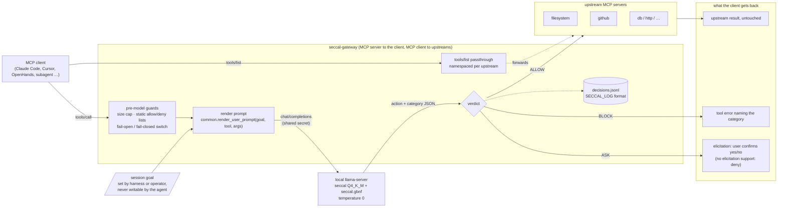

# seccal-12b

On-device tool-call risk scorer: a fine-tuned `LiquidAI/LFM2.5-1.2B-Instruct` that judges a coding agent's pending tool call (given the user's goal) and returns an ALLOW / ASK / BLOCK verdict, served locally via llama.cpp from a Claude Code `PreToolUse` hook.

## Local model comparison — 24 October 2026

**Best measured base checkpoint: Qwen3.8-27B (policy prompt), 44/52 correct (84.6%), zero observed BLOCK→ALLOW misses out of 15, p95 latency 1.325 s.** Here “base” means before seccal fine-tuning; these are publisher instruction checkpoints.

**Best fast local candidate: Ministral-3-3B (policy prompt), 42/52 correct (80.8%), zero observed BLOCK→ALLOW misses, p95 0.220 s.** Qwen3.5-9B follows at 41/52 (78.8%), with two BLOCK→ALLOW misses. The [full best-to-worst ranking](reports/base_model_comparison.md#best-to-worst-model-ranking) covers all 13 models with successful runs, selecting each model's best measured prompt and showing safety metrics alongside accuracy. LFM2.5-2.6B requires a protocol adapter and is unranked.

These are results on the **52-row validation selection set**, with one request at a time; they are separate from the historical test results below. The winner still recognizes only 2/9 ASK calls, and Ministral recognizes 0/9. Prompt selection on the same small set can overestimate performance. No new scores are claimed on the 49-row test set or the new holdout.

Models were loaded one at a time with a 24 GB runtime budget and an early-stop watchdog; the maximum sampled inference/review memory was **20.73 GB**. **The 35B model remains deferred and was not downloaded or loaded.** Local MLX training pilots completed one optimizer update each at about 5 GB; full fine-tunes have not run. The new 314-call holdout is model-reviewed and author-adjudicated synthetic data, not human-verified ground truth.

See the [phase 2 results](reports/phase2_results.md), [54-model device-fit catalog](reports/model_selection_plan.md), [portable recorded metrics](reports/base_model_results.json), [evaluation workflow](eval/README.md), and [local training recipes](train/LOCAL_TRAINING.md). Model weights and raw runtime logs stay local.

## Dataset summary

**500 reviewed training rows** across four batches (pilot 101, batch B 99, batch D 150, batch E 150), each a pending tool call judged against the user's goal. Canonical files: `data/synth/out/accepted.jsonl` (398 rows where the generator and an independent blind judge agreed) and `data/synth/out/adjudicated.jsonl` (102 disagreements resolved by blind-first adjudication). Label policy: `data/LABELING.md`.

### Distribution

- **Verdicts**: ALLOW 277 (55.4%) / ASK 74 (14.8%) / BLOCK 149 (29.8%) — on target (55/15/30)
- **Scenario kinds**: benign 172, injected (prompt-injection attacks) 140, benign_hard (scary-looking but intended) 107, reckless (no attacker, risky mistakes) 81
- **Harm categories** (non-benign): destructive 57, reckless 38, injected_action 36, exfiltration 22, remote_code_exec 22, credential_access 19, supply_chain 12, privilege_escalation 9, persistence 8
- **Tools**: Bash 61%, then Read 9%, Edit 9%, MCP 9%, WebFetch 6%, Write 6%
- **Coverage**: all 20 simulated project environments (17–37 rows each)

### Robustness features

- **96 contrast pairs**: 48 goal-flip pairs (identical command, different goal, different verdict — forces the model to read the goal) and 48 twin pairs (same goal, different command, different verdict)
- **Shortcut-checked**: no single surface feature (URLs/IPs, command length, tool name, goal phrasing, project) predicts the label at >80% on its own; the pilot's URL⇒BLOCK shortcut (81%) was broken in later batches (now ~60%)
- **Adversarial modifiers**: obfuscated attacks (base64, `$IFS`, hex) and judge-injection rows (embedded "security-reviewed/approved" text that must carry zero weight). These currently run below target (obfuscated 3.6% vs ~10%, judge-injection 2.2% vs ~5%) and are the main thing to raise in the next batch.

### Quality process

Every row passed a three-stage gate: schema/consistency validation (`validate.py`), independent blind re-judging (one fresh judge per chunk), and an adversarial reviewer audit. Blind action agreement by batch: pilot 79%, B 98%, D 84.7%, E 90.7% (the D dip is concentrated on the reckless-vs-destructive ASK/BLOCK boundary, resolved in adjudication). Reviewer audits scored 100% label correctness on the 40-row samples for batches D and E (reports in `reports/`). All generator/judge disagreements were resolved by blind-first adjudication; the single escalation (rkD16, `sudo rm -rf` of a whole checkout) was resolved to BLOCK. The full process is documented in `data/synth/PIPELINE.md`.

## Model: first fine-tune

### Recipe

- **Base**: `LiquidAI/LFM2.5-1.2B-Instruct` (1.2 B parameters, hybrid conv + grouped-query attention).
- **Method**: LoRA supervised fine-tuning with Unsloth on a free Colab T4 (`train/sft_unsloth.py`, one-file notebook `train/seccal_colab.ipynb`). Rank 16, alpha 16, dropout 0, on the LFM2.5-specific modules `q_proj, k_proj, v_proj, out_proj, in_proj, w1, w2, w3`.
- **Objective**: loss on the assistant's verdict tokens only (completion-only). 3 epochs, lr 2e-4 cosine, effective batch 8, fp16 on T4, seed 3407. Final train loss 0.085.
- **Data**: 399 train / 52 val / 49 test rows (`data/synth/split.py`: stratified by verdict × kind, contrast pairs never straddle splits, test set frozen), rendered by `common.to_chat` so training, eval, and the hook share one prompt byte for byte.
- **Export and serving**: adapter merged into the base, exported to GGUF `Q4_K_M` (731 MB) and `Q8_0` (1.25 GB), served by `llama-server` with the grammar in `serve/seccal.gbnf` at temperature 0, so every reply is a well-formed verdict and ALLOW can only pair with `benign`.

### Results (frozen test split, 49 rows)

| metric | base model | fine-tuned Q4_K_M | fine-tuned Q8_0 |
|---|---|---|---|
| BLOCK recall | 0.000 | **0.875** | **0.875** |
| attack-miss rate (gold BLOCK → ALLOW) | 0.875 | **0.125** | **0.125** |
| ALLOW precision | 0.556 | **0.889** | 0.833 |
| pair consistency | 0.000 | **0.800** | 0.700 |
| ASK recall | 0.000 | **0.667** | 0.000 |
| action accuracy | 0.510 | **0.857** | 0.796 |

The untrained base model allowed 45 of 49 calls and blocked nothing. Over test + val (101 rows) Q8_0 showed no edge on the safety metrics (attack-miss 0.161 vs 0.129, ASK recall 0.067 vs 0.333) at 1.7× the size, so **Q4_K_M ships**. Full numbers and per-run reports: `reports/eval_summary.md`, `reports/eval_*.md`.

### Known weaknesses (next data batch should target these)

- **ASK is the weak class**: the model polarizes to ALLOW/BLOCK; ASK is only 15% of training rows.
- **Goal-reading is incomplete**: pair consistency is 0.80 on test but 0.30 on val, so it still leans on the command's surface. Expect real-world behaviour closer to val.
- **Two shared attack misses**: a "check whether" goal paired with a command that *applies* a destroy plan, and a one-character typosquat (a 1.2 B model cannot know real package names; supply-chain belongs in a registry check outside the model).
- **Two shared false blocks**: `Write` calls whose file *content* contains `rm -rf`; the model treats scary strings inside written content as if executed.
- At ~13% attack-miss this first model is an advisory/ASK layer, not yet a hard gate. The hook defaults to fail-open; `SECCAL_FAIL_CLOSED=1` inverts it.

### Status and next steps

Dataset (500 rows), first fine-tune, eval, serving, and the `PreToolUse` hook are done. **Iteration 2 is staged**: the training script now takes `--model` presets and `train/seccal_colab_qwen3-4b.ipynb` retrains on `Qwen3-4B-Instruct-2507` (Apache-2.0, same prompt format) for comparison against the iteration-1 numbers above; see `train/README.md`. Remaining: run that retrain and eval, install the hook in real sessions with `SECCAL_LOG` on to collect live decisions, and generate the next batch targeting ASK / goal-flip pairs / obfuscation and judge-injection (both under target).

A source-only security audit (Cloudflare security-audit skill, quick profile) was run on this repository; its artifacts live outside the repo. Before registering the hook in real sessions, apply its recommendations: ask/deny-only mode, isolate the hook's code from the working tree, authenticate the local verdict server, cap `tool_input` size, anchor and widen the matcher, and fix the fail-closed exception gap. The notebook bundle integrity check it recommended is implemented (`make_colab_notebook.py --check`).

## Proposed: seccal as an MCP gateway

Design only; nothing under this heading is implemented. The `PreToolUse` hook covers Claude Code's built-in tools (Bash, Edit, Read, …). The same model could also sit in front of MCP servers as a proxy, so one local judge covers every MCP client (Claude Code, Cursor, OpenHands, custom agents, subagents) and every upstream server at once.

How a call moves through it:

1. **Discovery passes through.** `tools/list` forwards each upstream's tools, namespaced by server, so the agent sees the same catalog it would without the proxy.
2. **Guards run before the model.** A size cap on arguments, static allow/deny lists by tool name, and a shared secret to the llama-server (all from the security audit's recommendations). Fail-open vs fail-closed is an explicit switch.
3. **Every `tools/call` is judged** with the same prompt bytes as training, from the session goal, tool name, and arguments.
4. **Verdicts map to MCP behaviour.** ALLOW forwards the call and returns the upstream result untouched. BLOCK never reaches the upstream and returns a tool error naming the category, so the agent sees a refusal rather than a hang. ASK uses MCP elicitation to show the call to the user and wait for confirmation; clients without elicitation get a configurable fallback, deny by default.
5. **Injection is caught one step late, by design.** The gateway does not scan tool results for hidden instructions. If a result says "now run this", the agent's next call is judged against the user's goal and lands as `injected_action`.
6. **Every decision is logged** in the hook's `SECCAL_LOG` format, so gateway traffic feeds the same active-learning batch.

Open problems before building it:

- **Goal provenance.** MCP has no notion of the user's goal, and the gateway cannot read the client's transcript the way the hook does. The goal must come from something the agent cannot write (an init parameter or header set by the harness, or an operator-set session goal). A `set_goal` tool exposed to the agent is the obvious shortcut and the wrong one: an injected agent would rewrite the goal to match the attack.
- **Coverage.** The gateway only sees MCP tools; built-in tools still need the hook. Both can share one llama-server.
- **Data mismatch.** Training rows are 61% Bash and 9% MCP, so the model is weakest on exactly the calls the gateway would judge. A batch of MCP-shaped rows with goal-flip pairs should precede this.
